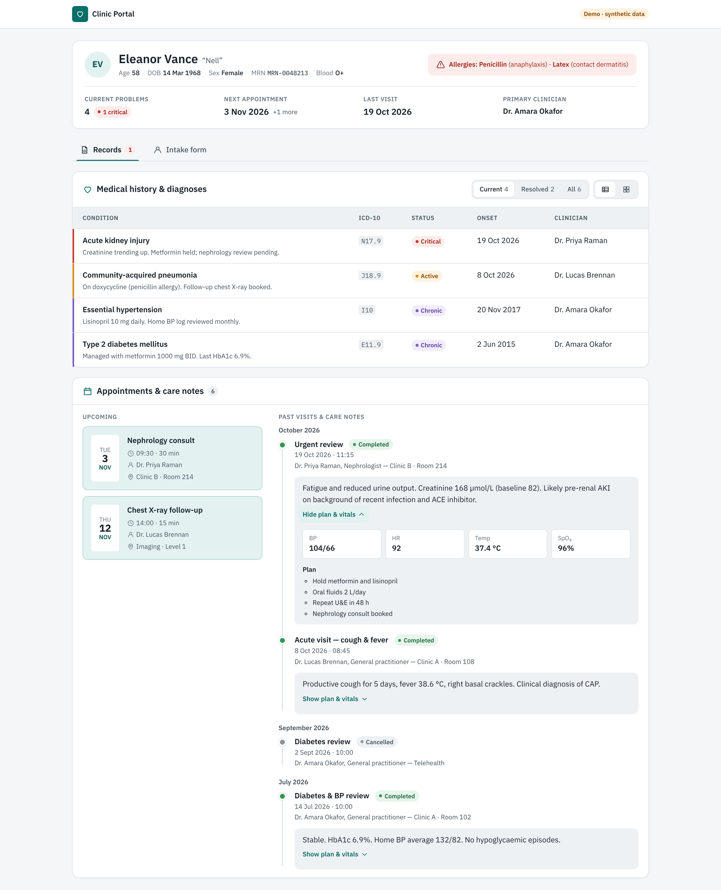
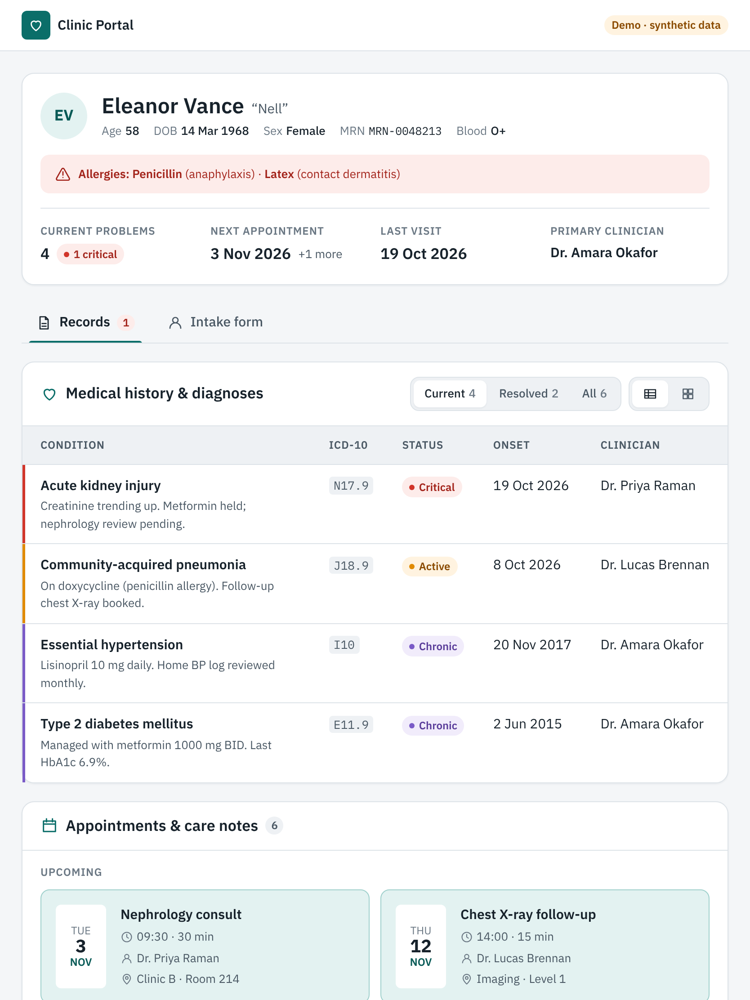
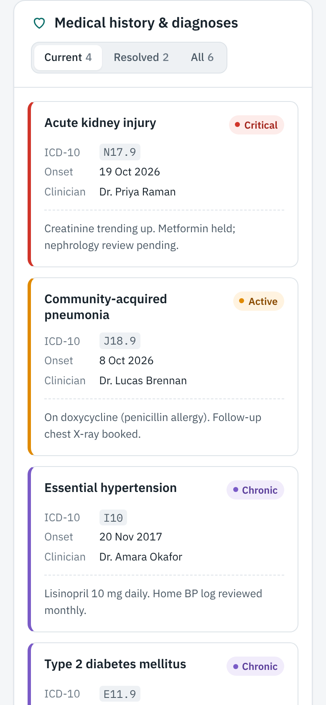
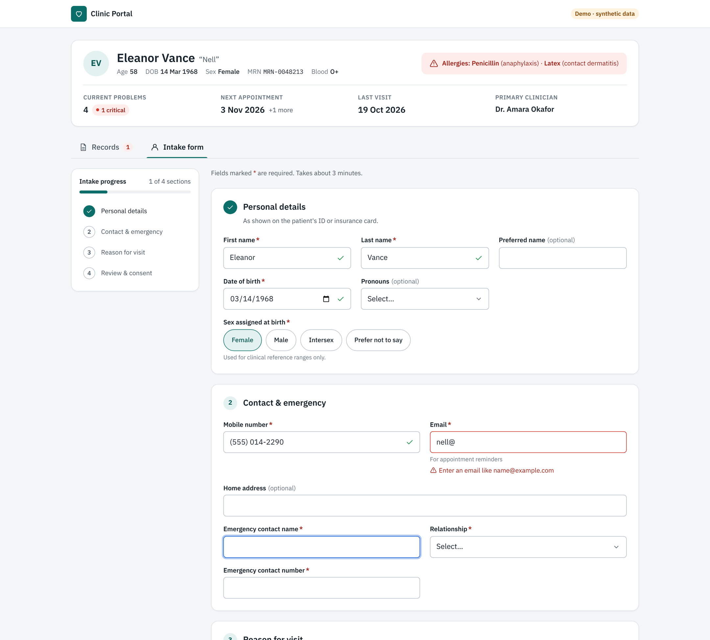
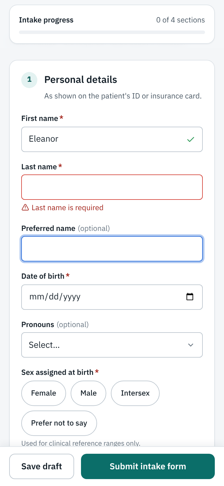

# Patient Forms & Records — UI Revamp

A working demo of how I'd modernise the **Patient Forms and Records** area of a React + Vite healthcare app: lighter forms, records you can read at a glance, and layouts that hold up on desktop, tablet and phone.

All styling goes through **SCSS Modules and design tokens**. The components are small, reusable and documented in **Storybook**. Business logic and API calls are deliberately left out: in a real codebase these components wrap the existing handlers instead of replacing them.

> ⚠️ All patient data in this repo is **synthetic**. No real PHI is used anywhere.

**▶ Live demo:** `https://<your-username>.github.io/healthcare-ui-revamp/`
**▶ Storybook:** `https://<your-username>.github.io/healthcare-ui-revamp/storybook/`

| Desktop ≥ 1280 | Tablet 768–1279 | Mobile ≤ 767 |
|---|---|---|
|  |  |  |

| Intake form — desktop (inline validation + progress) | Intake form — mobile (sticky progress + actions) |
|---|---|
|  |  |

---

## What's in it

### Forms that are faster to complete
- **Grouped fieldsets** (`FormSection`): numbered sections, each a semantic `<fieldset>`/`<legend>`. Fields sit on a 1 / 2 / 3-column responsive grid.
- **Inline validation that's forgiving**: a field is checked the first time you leave it, then re-checked on every keystroke so the error disappears as soon as it's fixed. Valid fields get a subtle ✓.
- **Error summary on submit**: it takes focus, announces the problems, and each item jumps straight to its field.
- **Progress tracking**: a sticky bar on phones and tablets, and a jump-to-section list on desktop. Each section's tick turns on as soon as its required fields pass.
- **Correct keyboards and autofill**: `inputMode`, `autoComplete` and `type="tel|email|date"` are set on every field.
- **Choice chips** instead of a dropdown when there are 5 or fewer options, so the answer takes one tap instead of three.
- **Sticky action bar on phones**, so Submit is always within thumb reach.

### Records you can read at a glance
- **Patient banner**: identity, MRN and a **red allergy alert** are always at the top, with tiles for current problems, next appointment, last visit and clinician.
- **Medical history & diagnoses**: sorted by clinical priority (critical → active → chronic → resolved). Filter by Current / Resolved / All, and switch between **table and card views**. Phones always get cards, so nothing scrolls sideways.
- **Appointments & care notes**: upcoming visits as date cards, and past visits on a timeline grouped by month. Each care note shows its summary first, with **plan & vitals in an expandable section** below it.
- **Status is never shown by colour alone**: every status chip has a dot and a text label, and colours meet WCAG AA contrast.

### Accessibility
- Every control has a real `<label>`, plus `aria-describedby` wiring for hints and errors, and `aria-invalid`.
- Tabs follow the WAI-ARIA pattern (roving tabindex; ← → Home End keys).
- Includes a skip link, visible `:focus-visible` rings, 44 px touch targets, and a check that tab order matches visual order.
- Animations respect `prefers-reduced-motion`. Light and dark themes are both driven by tokens.
- Storybook ships with `@storybook/addon-a11y` (axe) on every story.

---

## Breakpoints

| Name | Range | Mixin |
|---|---|---|
| Mobile | ≤ 767 px | `@include mobile-only` |
| Tablet | 768 – 1279 px | `@include tablet-up` / `tablet-only` |
| Desktop | ≥ 1280 px | `@include desktop-up` |

These are defined once in [`src/styles/_mixins.scss`](src/styles/_mixins.scss). JavaScript-side layout decisions, such as forcing the card view on phones, use the same values through `useMediaQuery`.

## Project structure

```
src/
├─ styles/
│  ├─ _tokens.scss        # colours, type scale, spacing, radius, motion (light + dark)
│  ├─ _mixins.scss        # breakpoints, focus ring, visually-hidden, motion-safe
│  └─ global.scss
├─ components/            # reusable, app-agnostic building blocks
│  ├─ Button/  Card/  Collapsible/  DataView/  EmptyState/
│  ├─ ErrorSummary/  Field/  FormSection/  Icon/
│  ├─ SegmentedControl/  StatusChip/  Tabs/
│  └─ index.ts            # public API
├─ features/
│  ├─ patient-forms/      # PatientIntakeForm, FormProgress, intakeSchema
│  └─ patient-records/    # PatientBanner, MedicalHistory, AppointmentsPanel
├─ hooks/                 # useFormValidation, useMediaQuery
├─ lib/                   # validators (+ tests), formatters
└─ data/                  # synthetic patient data + types
```

Each component lives in its own folder as `Component.tsx` + `Component.module.scss` + `Component.stories.tsx`.

## Run it

```bash
npm install
npm run dev              # app on http://localhost:5173
npm run storybook        # Storybook on http://localhost:6006
npm test                 # validator unit tests
npm run build            # type-check + production build
```

## Deploying the demo (GitHub Pages)

1. Push to `main`.
2. In the repo, go to **Settings → Pages → Source** and choose **GitHub Actions**.
3. The workflow in `.github/workflows/deploy.yml` builds the app and Storybook, and publishes them to `/` and `/storybook/`.

## How this maps onto an existing codebase

See **[docs/HANDOFF.md](docs/HANDOFF.md)**. It covers how to adopt the tokens, how to wrap legacy inputs without changing their props, and how to roll the components out to dashboards and reports next.

---

**Stack:** React 18 · Vite 6 · TypeScript · SCSS Modules · Storybook 8 · Vitest
